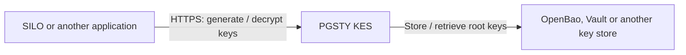

# PGSTY KES

PGSTY KES (Key Encryption Service) manages encryption keys for applications
such as [SILO](https://github.com/pgsty/silo). It is an independent,
community-maintained fork of [MinIO KES](https://github.com/minio/kes).
The upstream open-source repository is deprecated. This project is not
affiliated with, endorsed by, or sponsored by MinIO, Inc.

- [What is KES?](#what-is-kes)
- [Installation](#install)
- [Quick Start](#quick-start)
- [Documentation](#docs)
- [Compatibility and attribution](#compatibility-and-attribution)

## What is KES?

KES runs as a separate `kes` executable. Applications ask it to generate or
decrypt data encryption keys. The application encrypts its own data; KES
controls access to the root keys that protect those data encryption keys.



For a persistent deployment, configure an external key store. Multiple KES
instances can share that store. OpenBao and Vault use the `keystore.vault`
configuration. The development server instead keeps keys in memory and loses
them when it stops.

## Install

PGSTY release artifacts are published at
[pgsty/kes releases](https://github.com/pgsty/kes/releases). Until the first
PGSTY release is published, build this checkout with the Go version in
[go.mod](go.mod):

```sh
git clone https://github.com/pgsty/kes.git
cd kes
go build -trimpath -o kes ./cmd/kes
./kes --version
```

The release pipeline builds Linux, macOS and Windows archives for AMD64 and
ARM64, plus Linux RPM, DEB and APK packages. Container publication targets
`docker.io/pgsty/kes` and is a separate, manually invoked step. See the
release list for available artifacts.

`kes update` is disabled in this fork. Upgrade through packages, images or
verified PGSTY release artifacts. See [RELEASING.md](RELEASING.md) for build,
verification and publication steps.

## Quick Start

Start a local development server in one terminal:

```sh
./kes server --dev --addr 127.0.0.1:7373
```

Keep it running. In another terminal in the same directory, copy the generated
**API Key** from its output and create a key:

```sh
export KES_SERVER=https://127.0.0.1:7373
export KES_API_KEY='<API Key printed by your local server>'
./kes key create --insecure my-key
./kes key dek --insecure my-key
```

The DEK response contains a plaintext key for encrypting data and an encrypted
copy to store alongside that data. Only this local example uses `--insecure`,
because development mode generates a self-signed TLS certificate. Do not use
this in-memory server for persistent encrypted data.

For a persistent deployment, configure your TLS certificate, application
identities, access policies and key store in [server-config.yaml](server-config.yaml),
then run `kes server --config /path/to/server-config.yaml`.

## Docs

- [Server configuration](server-config.yaml): TLS, identities, policies, caching
  and supported key stores.
- CLI reference: `kes --help`, `kes server --help` and `kes <command> --help`.
- [SILO documentation](https://silo.pgsty.com/): application integration and operations.
- [KES Go client SDK](https://pkg.go.dev/github.com/minio/kms-go/kes): the
  upstream client library used by this fork.
- [Release workflow](RELEASING.md), [contribution guide](CONTRIBUTING.md) and
  [security policy](SECURITY.md).

### Monitoring

KES exposes Prometheus metrics at `/v1/metrics`. Configure the scraper with
TLS trust and an identity whose policy permits that endpoint. Import the
[PGSTY KES Grafana dashboard](examples/grafana/dashboard.json) and select your
Prometheus data source. Metric names are unchanged for existing dashboards.

### Insufficient permissions

An identity must be the configured admin or belong to a policy that permits
the requested API path. Check the `admin` and `policy` sections in
[server-config.yaml](server-config.yaml). For example, creating `my-key`
requires `/v1/key/create/my-key`, or a matching allow pattern. Deny rules take
precedence over allow rules. Give applications only the permissions they need.

## Compatibility and attribution

The product name is **PGSTY KES**; the executable and package remain `kes`.
The HTTP API, configuration fields, stored key format and metric names are
preserved. SILO continues to connect through its existing `MINIO_KMS_KES_*`
settings.

The CLI accepts these environment variables in the existing order of
precedence (leftmost set variable wins):

| Setting | Environment variables |
| --- | --- |
| Server | `MINIO_KES_SERVER` → `KES_SERVER` → `MINIO_KMS_KES_ENDPOINT` |
| API key | `MINIO_KES_API_KEY` → `KES_API_KEY` → `MINIO_KMS_KES_API_KEY` |
| Client private key | `MINIO_KES_KEY_FILE` → `KES_CLIENT_KEY` → `MINIO_KES_CLIENT_KEY` |
| Client certificate | `MINIO_KES_CERT_FILE` → `KES_CLIENT_CERT` → `MINIO_KES_CLIENT_CERT` |

The Go module path `github.com/minio/kes`, upstream SDK dependencies and
Protobuf namespace `miniohq.kms` are retained for compatibility. Build the
PGSTY checkout to use this fork; installing the upstream module does not
select PGSTY source.

## License

KES is licensed under the GNU AGPL v3.0; see [LICENSE](LICENSE).
Original source copyright headers, third-party notices in [CREDITS](CREDITS)
and upstream attribution in [NOTICE](NOTICE) are preserved. PGSTY modifications
are credited separately.

MinIO is a trademark of MinIO, Inc. References to MinIO identify the upstream
project, its authors or compatibility identifiers. They do not imply endorsement
of this fork.
