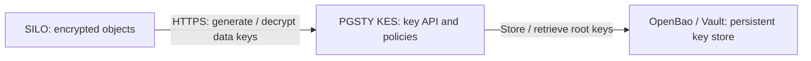

<h1 align="center">PGSTY KES</h1>

<p align="center">
  <strong>Key encryption for SILO — a MinIO KES fork maintained by PGSTY</strong>
</p>

<p align="center">
  <a href="#overview">Overview</a> ·
  <a href="#quick-start">Quick Start</a> ·
  <a href="https://github.com/pgsty/kes/releases">Releases</a> ·
  <a href="#compatibility">Compatibility</a> ·
  <a href="#docs">Documentation</a> ·
  <a href="SECURITY.md">Security</a> ·
  <a href="README_ZH.md">中文</a>
</p>

<p align="center">
  <a href="https://github.com/pgsty/kes/actions/workflows/go.yml"></a>
  <a href="https://github.com/pgsty/kes/actions/workflows/kms-compat.yml"></a>
  <a href="go.mod"></a>
  <a href="LICENSE"></a>
</p>

> [!IMPORTANT]
> **PGSTY KES** is an independent, community-maintained fork of the open-source [MinIO KES](https://github.com/minio/kes), maintained in [`pgsty/kes`](https://github.com/pgsty/kes) for the SILO ecosystem. It is not affiliated with, endorsed by, or sponsored by MinIO, Inc. References to MinIO identify the upstream project, its authors or compatibility identifiers.

## Current release and development

The first PGSTY KES release is in preparation. As of **2026-10-17**, this repository has no published PGSTY releases. Use the source build below; [GitHub Releases](https://github.com/pgsty/kes/releases) records which artifacts are available.

The build pipeline validates binaries, packages and a container image before publication. Signed release tags prepare a Draft GitHub Release; container publication is a separate step. Build and signing procedures are documented in [RELEASING.md](RELEASING.md).

<a id="what-is-kes"></a>

## Overview

KES stands for **Key Encryption Service**. Applications use it to generate and decrypt data encryption keys. KES authenticates callers, enforces access policies and protects those data encryption keys with root encryption keys held in a configured key store.

A deployment using SILO and OpenBao has three separate services:

| Component | Responsibility |
| :-- | :-- |
| **SILO** (`silo`) | Stores S3 objects and encrypts/decrypts their contents. Calls KES for data encryption keys. |
| **PGSTY KES** (`kes`) | Serves the key API, checks application identities and policies, and generates or decrypts data encryption keys. |
| **OpenBao / Vault** | Persists KES root keys through its key-value secrets API. KES uses the `keystore.vault` backend to access it. |



SILO already connects to KES through its `MINIO_KMS_KES_*` settings. Deploy `kes` as a separate service, configure its key store, and give SILO an identity and policy for the required keys. The same `kes` binary also provides the administration CLI. Multiple KES instances can share one external key store.

**Related:** [`pgsty/silo`](https://github.com/pgsty/silo) object storage · [`pgsty/mc`](https://github.com/pgsty/mc) S3 client (`mcli`) · [`OpenBao`](https://openbao.org/docs/secrets/kv/) key store · [`pgsty/pigsty`](https://github.com/pgsty/pigsty)

## Quick Start

Install the Go toolchain selected by [go.mod](go.mod), then build this checkout:

```bash
git clone https://github.com/pgsty/kes.git
cd kes
go build -trimpath -o kes ./cmd/kes
./kes --version
./kes server --dev --addr 127.0.0.1:7373
```

Keep the server running. In another terminal in the same directory, copy the generated **API Key** from its output:

```bash
export KES_SERVER=https://127.0.0.1:7373
export KES_API_KEY='<API Key printed by your local server>'
./kes key create --insecure my-key
./kes key dek --insecure my-key
```

The DEK response contains a plaintext key for encrypting data and an encrypted copy to store alongside that data. This example uses `--insecure` because development mode generates a self-signed TLS certificate.

> [!WARNING]
> Development mode keeps keys in memory and loses them when the server stops. For persistent deployments, configure TLS trust, application identities, least-privilege policies and a persistent key store in [server-config.yaml](server-config.yaml). Back up the key store and test recovery: encrypted objects require their original keys to remain readable.

Start a configured server with `kes server --config /path/to/server-config.yaml`.

## Install

The build pipeline produces the following formats. Until the first release is published, use the source build above.

| Method | Target and availability |
| :-- | :-- |
| Source | `go build -trimpath -o kes ./cmd/kes` from the PGSTY checkout |
| Binaries | Linux, macOS and Windows on `amd64` and `arm64`; distributed through [GitHub Releases](https://github.com/pgsty/kes/releases) |
| Packages | RPM, DEB and APK for Linux on `amd64` and `arm64`; distributed as release assets |
| Container | Publication target `docker.io/pgsty/kes`, for `linux/amd64` and `linux/arm64`; published separately after a GitHub release |

Packages install `/usr/local/bin/kes`. Provision configuration, certificates, a key store and service management separately. Archives include both READMEs, LICENSE, NOTICE and CREDITS.

The release process provides SHA-256 checksums and GitHub build attestations for archives, DEBs and APKs; RPMs are signed on a maintainer machine before publication. See [RELEASING.md](RELEASING.md) for the verification and publication procedure.

`kes update` is disabled. Upgrade using verified PGSTY artifacts, packages or images. The executable and package name remain `kes`.

<a id="compatibility-and-attribution"></a>

## Compatibility

PGSTY KES preserves the KES HTTP API, configuration fields, key storage format, metric names and existing environment variables. The Go module path `github.com/minio/kes`, upstream SDK dependencies and Protobuf namespace `miniohq.kms` are retained for compatibility. See [go.mod](go.mod) for the selected dependencies. Build the PGSTY checkout to use this fork; installing the upstream module does not select PGSTY source.

The release-gating integration is **SILO + PGSTY KES + OpenBao KV v2**. The [CI matrix](.github/workflows/kms-compat.yml) lists the tested SILO releases. Its [integration test](testing/kms-compat.sh) checks that objects encrypted through the last upstream KES release remain readable after upgrading KES, then verifies new encrypted writes. Compatibility with unmodified upstream MinIO is best effort. Other inherited key-store backends are listed in [server-config.yaml](server-config.yaml); the SILO/OpenBao test does not certify every backend.

<details>
<summary>CLI environment variable precedence</summary>

The first set variable in each row wins, preserving the existing lookup order:

| Setting | Environment variables |
| :-- | :-- |
| Server | `MINIO_KES_SERVER` → `KES_SERVER` → `MINIO_KMS_KES_ENDPOINT` |
| API key | `MINIO_KES_API_KEY` → `KES_API_KEY` → `MINIO_KMS_KES_API_KEY` |
| Client private key | `MINIO_KES_KEY_FILE` → `KES_CLIENT_KEY` → `MINIO_KES_CLIENT_KEY` |
| Client certificate | `MINIO_KES_CERT_FILE` → `KES_CLIENT_CERT` → `MINIO_KES_CLIENT_CERT` |

</details>

Pin versions, retain your key-store data and verify decryption before and after an upgrade. Branding changes do not require renaming keys or rewriting encrypted objects.

## Docs

This repository contains the KES configuration reference, examples and contributor/release instructions. The [SILO documentation](https://silo.pgsty.com/docs/) covers the object-storage server and its operations.

<a id="monitoring"></a>

| Topic | Reference |
| :-- | :-- |
| Server configuration | [server-config.yaml](server-config.yaml): TLS, identities, policies, caching and key stores |
| CLI | `kes --help`, `kes server --help`, `kes <command> --help` |
| SILO / OpenBao integration | [Tested configuration and upgrade exercise](testing/kms-compat.sh) — a test fixture, not a production deployment recipe |
| Monitoring | `/v1/metrics` and the [Grafana dashboard](examples/grafana/dashboard.json); configure TLS trust and an identity permitted to read metrics |
| Go client | [`github.com/minio/kms-go/kes`](https://pkg.go.dev/github.com/minio/kms-go/kes), the upstream SDK used by this fork |
| Build and release | [RELEASING.md](RELEASING.md) |

<a id="insufficient-permissions"></a>

For `insufficient permissions`, check the identity and matching API paths in the `admin` and `policy` configuration. Deny rules take precedence over allow rules.

## Security & Contributing

Report vulnerabilities privately as described in [SECURITY.md](SECURITY.md). Fixes are developed on `master`, with upgrade guidance in this repository's [security advisories](https://github.com/pgsty/kes/security/advisories) and release notes.

Contributions use the project's AGPLv3 license, with no CLA or copyright assignment. Sign off commits with `git commit -s`; see [CONTRIBUTING.md](CONTRIBUTING.md). We credit the upstream KES authors and everyone contributing fixes, integration work and reports to this fork.

## Background

Upstream [deprecated its open-source KES repository in May 2025](https://github.com/minio/kes/blob/63649d0ea9be882887631cf315c4655f3c090d8f/README.md). PGSTY maintains this fork for deployments that need the KES protocol and SILO integration, with a focus on dependency and security maintenance, verified release artifacts and tested upgrades.

The maintenance approach follows SILO: identify the maintained product and its artifacts clearly, preserve protocols and stored data, retain original authorship, and document intentional behavior changes. Current maintenance and release procedures are in [MAINTAINERS.md](MAINTAINERS.md) and [RELEASING.md](RELEASING.md).

<a id="license"></a>

## License & Trademark

PGSTY KES is licensed under [AGPL-3.0-only](LICENSE), derived from [`minio/kes`](https://github.com/minio/kes). Original source copyright headers, upstream attribution in [NOTICE](NOTICE) and third-party notices in [CREDITS](CREDITS) are preserved. MinIO's 2015–2025 work and PGSTY's 2026 modifications are credited separately.

MinIO is a trademark of MinIO, Inc. The name is used here only to identify the upstream project, its authors and compatibility lineage; it does not imply endorsement of this fork.
