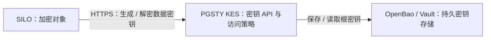

<h1 align="center">PGSTY KES</h1>

<p align="center">
  <strong>为 SILO 提供密钥加密服务 —— 由 PGSTY 维护的 MinIO KES 社区分支</strong>
</p>

<p align="center">
  <a href="#overview">概述</a> ·
  <a href="#quick-start">快速上手</a> ·
  <a href="https://github.com/pgsty/kes/releases">版本发布</a> ·
  <a href="#compatibility">兼容性</a> ·
  <a href="#docs">文档</a> ·
  <a href="SECURITY.md">安全策略</a> ·
  <a href="README.md">English</a>
</p>

<p align="center">
  <a href="https://github.com/pgsty/kes/actions/workflows/go.yml"></a>
  <a href="https://github.com/pgsty/kes/actions/workflows/kms-compat.yml"></a>
  <a href="go.mod"></a>
  <a href="LICENSE"></a>
</p>

> [!IMPORTANT]
> **PGSTY KES** 是面向 SILO 生态、在 [`pgsty/kes`](https://github.com/pgsty/kes) 独立维护的开源 [MinIO KES](https://github.com/minio/kes) 社区分支。本项目与 MinIO, Inc. 不存在隶属、背书或赞助关系；文中使用 “MinIO” 仅用于说明上游项目、原作者及兼容性标识。

## 当前发行状态

PGSTY KES 正在准备首个发行版。截至 **2026-10-17**，本仓库尚未发布 PGSTY 发行版。目前请按下文从源码构建；实际可用的制品以 [GitHub Releases](https://github.com/pgsty/kes/releases) 为准。

构建流水线会在发布前验证二进制、软件包和容器镜像。签名版本标签用于准备 GitHub Draft Release，容器镜像另行发布。构建、签名与发布流程见 [RELEASING.md](RELEASING.md)。

<a id="overview"></a>

## 概述

KES 是 **Key Encryption Service（密钥加密服务）** 的缩写。应用通过它生成或解密数据加密密钥。KES 验证调用者身份、执行访问策略，并用配置在密钥存储中的根密钥保护这些数据加密密钥。

采用 SILO 和 OpenBao 时，一套部署包含三个独立服务：

| 组件 | 职责 |
| :-- | :-- |
| **SILO**（`silo`） | 存储 S3 对象，加密和解密对象内容；向 KES 请求数据加密密钥。 |
| **PGSTY KES**（`kes`） | 提供密钥 API，检查应用身份与策略，生成或解密数据加密密钥。 |
| **OpenBao / Vault** | 通过键值机密 API 持久保存 KES 根密钥；KES 使用 `keystore.vault` 后端访问它。 |



SILO 已能通过 `MINIO_KMS_KES_*` 配置连接 KES。部署时单独运行 `kes` 服务，配置密钥存储，并为 SILO 分配只能访问所需密钥的身份与策略。同一个 `kes` 二进制也提供管理命令行；多个 KES 实例可以共用一个外部密钥存储。

**相关项目：**[`pgsty/silo`](https://github.com/pgsty/silo) 对象存储 · [`pgsty/mc`](https://github.com/pgsty/mc) S3 客户端（`mcli`） · [`OpenBao`](https://openbao.org/docs/secrets/kv/) 密钥存储 · [`pgsty/pigsty`](https://github.com/pgsty/pigsty)

<a id="quick-start"></a>

## 快速上手

安装 [go.mod](go.mod) 指定的 Go 工具链，然后构建本仓库：

```bash
git clone https://github.com/pgsty/kes.git
cd kes
go build -trimpath -o kes ./cmd/kes
./kes --version
./kes server --dev --addr 127.0.0.1:7373
```

保持服务运行，在另一个终端进入同一目录，复制启动输出中的 **API Key**：

```bash
export KES_SERVER=https://127.0.0.1:7373
export KES_API_KEY='<API Key printed by your local server>'
./kes key create --insecure my-key
./kes key dek --insecure my-key
```

DEK 响应包含用于加密数据的明文密钥，以及应与数据一起保存的加密副本。开发模式会生成自签名 TLS 证书，因此这个本地示例使用 `--insecure`。

> [!WARNING]
> 开发模式只在内存中保存密钥，服务停止后密钥就会丢失。需要持久保存数据的部署，应在 [server-config.yaml](server-config.yaml) 中配置 TLS 信任、应用身份、最小权限策略和持久密钥存储。备份密钥存储并验证恢复流程：加密对象必须依赖原有密钥才能读取。

使用 `kes server --config /path/to/server-config.yaml` 启动已配置的服务。

<a id="install"></a>

## 安装

构建流水线生成以下格式；首个发行版发布前，请使用上面的源码构建方式。

| 方式 | 目标与获取位置 |
| :-- | :-- |
| 源码构建 | 在 PGSTY 仓库执行 `go build -trimpath -o kes ./cmd/kes` |
| 二进制 | Linux、macOS、Windows 的 `amd64` 与 `arm64`，通过 [GitHub Releases](https://github.com/pgsty/kes/releases) 分发 |
| 软件包 | Linux `amd64` 与 `arm64` 的 RPM、DEB、APK，作为发行版附件分发 |
| 容器镜像 | 发布目标为 `docker.io/pgsty/kes`，支持 `linux/amd64` 与 `linux/arm64`，在 GitHub 发行版发布后另行发布 |

软件包将程序安装到 `/usr/local/bin/kes`；配置文件、证书、密钥存储与服务管理需要另行准备。二进制压缩包包含中英文 README、LICENSE、NOTICE 和 CREDITS。

发布流程为压缩包、DEB 和 APK 提供 SHA-256 校验和及 GitHub 构建证明；RPM 在发布前由维护者本地签名。验证与发布步骤见 [RELEASING.md](RELEASING.md)。

`kes update` 已禁用。请通过经过验证的 PGSTY 制品、软件包或镜像升级。可执行文件与软件包名称保持为 `kes`。

<a id="compatibility"></a>

## 兼容性

PGSTY KES 保留 KES HTTP API、配置字段、密钥存储格式、监控指标名及既有环境变量。Go 模块路径 `github.com/minio/kes`、上游 SDK 依赖与 Protobuf 命名空间 `miniohq.kms` 也因兼容性保留。具体依赖见 [go.mod](go.mod)。使用本分支应构建 PGSTY 仓库；直接安装上游模块不会自动获得 PGSTY 源码。

发布验收组合为 **SILO + PGSTY KES + OpenBao KV v2**。[CI 矩阵](.github/workflows/kms-compat.yml) 列出参与测试的 SILO 版本；[集成测试](testing/kms-compat.sh) 会先通过上游最后一个 KES 发行版写入加密对象，再升级 KES，验证旧对象仍可读取并检查新的加密写入。对未修改的上游 MinIO 尽最大努力保持兼容。其他继承的密钥存储后端见 [server-config.yaml](server-config.yaml)；SILO/OpenBao 测试不代表所有后端均已通过认证。

AWS Secrets Manager 后端使用 AWS SDK for Go v2，保留现有 YAML 字段和密钥存储格式。显式配置的凭据优先；留空时通过 SDK 从环境变量、共享凭据文件或 IAM Role 获取。与原实现一致，KES 不加载 `~/.aws/config`，SDK 的端点环境变量也不会覆盖 KES 配置。额外的 CI 使用 Moto 模拟 Secrets Manager，验证 SDK v1/v2 升级、回滚和 SILO 加密读取，每次切换都会重启 SILO 以清除密钥缓存。这些本地检查不代表已经验证真实 AWS 的 IAM 策略和服务行为。

<details>
<summary>CLI 环境变量优先级</summary>

每行最左侧已设置的变量优先，保持既有查找顺序：

| 配置 | 环境变量 |
| :-- | :-- |
| 服务地址 | `MINIO_KES_SERVER` → `KES_SERVER` → `MINIO_KMS_KES_ENDPOINT` |
| API 密钥 | `MINIO_KES_API_KEY` → `KES_API_KEY` → `MINIO_KMS_KES_API_KEY` |
| 客户端私钥 | `MINIO_KES_KEY_FILE` → `KES_CLIENT_KEY` → `MINIO_KES_CLIENT_KEY` |
| 客户端证书 | `MINIO_KES_CERT_FILE` → `KES_CLIENT_CERT` → `MINIO_KES_CLIENT_CERT` |

</details>

升级时锁定版本、保留密钥存储数据，并在升级前后验证解密。品牌调整无需重命名密钥或重写加密对象。

<a id="docs"></a>

## 文档

本仓库保留 KES 配置参考、示例以及贡献和发布说明。[SILO 文档站](https://silo.pgsty.com/zh/docs/)负责对象存储服务端的使用与运维文档。

| 主题 | 入口 |
| :-- | :-- |
| 服务端配置 | [server-config.yaml](server-config.yaml)：TLS、身份、策略、缓存与密钥存储 |
| 命令行 | `kes --help`、`kes server --help`、`kes <command> --help` |
| SILO / OpenBao 集成 | [已验证的配置与升级演练](testing/kms-compat.sh)，这是测试夹具，不是生产部署方案 |
| 监控 | `/v1/metrics` 与 [Grafana 仪表盘](examples/grafana/dashboard.json)，需配置 TLS 信任及允许读取指标的身份 |
| Go 客户端 | 本分支使用的上游 SDK [`github.com/minio/kms-go/kes`](https://pkg.go.dev/github.com/minio/kms-go/kes) |
| 构建与发布 | [RELEASING.md](RELEASING.md) |

遇到 `insufficient permissions` 时，检查 `admin`、`policy` 中的身份和 API 路径匹配规则。拒绝规则优先于允许规则。

## 安全与贡献

请按照 [SECURITY.md](SECURITY.md) 私密报告漏洞。修复在 `master` 分支开发，升级说明通过本仓库的[安全公告](https://github.com/pgsty/kes/security/advisories)与发行说明提供。

贡献沿用项目的 AGPLv3 许可证，无需签署 CLA 或转让著作权。提交时使用 `git commit -s` 进行 DCO 签署，详见 [CONTRIBUTING.md](CONTRIBUTING.md)。感谢上游 KES 原作者，以及为本分支提交修复、集成工作与问题报告的贡献者。

## 背景

上游于 [2025 年 5 月宣布弃用开源 KES 仓库](https://github.com/minio/kes/blob/63649d0ea9be882887631cf315c4655f3c090d8f/README.md)。PGSTY 为需要 KES 协议和 SILO 集成的部署维护此分支，重点是依赖与安全维护、可验证的交付物及经过测试的升级路径。

维护方式沿用 SILO 的原则：明确产品与制品的维护方，保留协议和已存数据，保留原作者署名，并记录有意的行为变更。当前维护和发布流程见 [MAINTAINERS.md](MAINTAINERS.md) 与 [RELEASING.md](RELEASING.md)。

## 许可证与商标

PGSTY KES 采用 [AGPL-3.0-only](LICENSE)，衍生自 [`minio/kes`](https://github.com/minio/kes)。原有源码版权声明、[NOTICE](NOTICE) 中的上游归属与 [CREDITS](CREDITS) 中的第三方声明均予保留。MinIO 在 2015–2025 年的工作与 PGSTY 在 2026 年的修改贡献分别署名。

MinIO 是 MinIO, Inc. 的商标。此处使用仅为标识上游项目、原作者和兼容谱系，不代表上游对本分支的背书。
